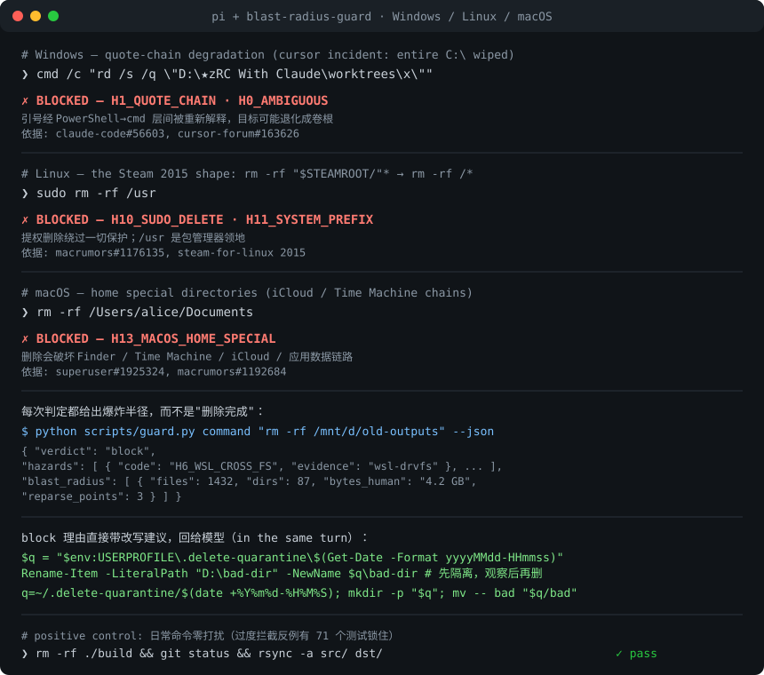

# blast-radius-guard

[](https://github.com/xinghe-labs/blast-radius-guard/actions/workflows/ci.yml)
[](LICENSE)
[](.github/workflows/ci.yml)

**在破坏性命令执行之前，判定它在 Windows / Linux / macOS 上的真实爆炸半径。**



一个 [Agent Skill](https://agentskills.io)：任何 agent（Claude Code / Codex / Cursor / pi）在跑 `rm -rf`、`rd /s /q`、`Remove-Item -Recurse -Force`、`sudo rm` 之前，先过一遍判定器，拿到 `allow / warn / block` 和带事故编号的理由。已经在真实 pi 会话里完成过端到端验证：模型发出的删除命令被扩展拦截，改写建议原样回到模型。

## 调用方式：三层

**③ 硬拦截（推荐，装完就和）**

- pi：安装本包后，`src/extension.ts` 拦截所有 bash/powershell 删除命令，block 级在执行前拒绝，改写建议直接回给模型
- Claude Code：`hooks/pretooluse.py` 挂进 `PreToolUse`，exit 2 硬拦截
- fail-open 设计：判定器缺失/超时一律放行——安全工具因为误拦被用户禁用，比偶尔漏拦更糟

**② 软自动（装 skill 即得）**

agent 读到 SKILL.md 的 description 后，删除前自觉跑判定器。对携带 hook 机制的宿主，这只是后备。

**① 手动 CLI**

```bash
python scripts/guard.py command 'rd /s /q "D:\★有些目录 with space"'
python scripts/guard.py command 'sudo rm -rf /usr'
python scripts/guard.py path "D:/old-outputs"
python scripts/guard.py command "rm -rf /mnt/d/data" --json
```

退出码：`0` = allow，`1` = warn（需人工确认），`2` = block（拒绝执行）。

`path` 模式只做**静态路径判定**（卷根 / 系统前缀 / 挂载点 / 大小写碰撞 / 链接计数），
没有命令语境，因此 H8（递归+通配符）、H9（永久删除）、H10（提权）不适用——
它们只能从命令文本推断。要完整判定请用 `command` 模式。

## 为什么是这个方向

AI agent 静默销毁用户数据的公开事故记录已经成了一类，横跨三大平台：

| 事故 | 平台 | 根因 | 造成的损失 |
|---|---|---|---|
| [claude-code#56603](https://github.com/anthropics/claude-code/issues/56603) | Windows | PowerShell→cmd 引号链断裂，路径含 Unicode+空格 | 整个 worktree 目录被清空 |
| [cursor 论坛](https://forum.cursor.com/t/severe-data-loss-agents-mis-quoted-rmdir-command-recursively-deleted-my-entire-c-drive-had-to-reinstall-windows/163626) | Windows | `rmdir /s /q` 引号退化成 `rmdir /s /q C:\` | **整盘 C:\ 被删除，重装系统** |
| [cursor 论坛](https://forum.cursor.com/t/agent-autonomous-rd-s-q-wiped-the-entire-d-drive-windows/174156.md) | Windows | 引号解析错误，`rd /s /q` 落到盘根 | 微信记录+源码+应用全毁 |
| [claude-code#60442](https://github.com/anthropics/claude-code/issues/60442) | Windows | NTFS 大小写不敏感，`rm -rf "D:\CampusconnECT"` 解析到真实目录 | **9 个生产代码库被毁** |
| [claude-code#68343](https://github.com/anthropics/claude-code/issues/68343) | Windows | CJK 路径经 PowerShell/WSL2 静默返回空输出 | agent 误判"文件不存在"，基于错误前提行动 |
| Claude Code v2.1.205 官方修复 | Windows | 删 worktree 穿透嵌套 NTFS junction，删到树外 | （官方 changelog 承认的 bug 类） |
| [codex#14487](https://github.com/openai/codex/issues/14487) | Windows | 默认权限下自主删除 D:\Photo，持续两天 | ~30MB×N 照片不可恢复 |
| Steam 2015 | Linux | `rm -rf "$STEAMROOT/"*` 变量为空退化成 `rm -rf /*` | **大量用户整盘 /usr 被删** |
| rsync 邮件列表 / 博客多人复述 | Linux | `rsync --delete` 作用于挂载点，误清备份卷 | 备份卷整卷数据消失 |
| macrumors#1176135 | macOS | `sudo rm -R / .Spotlight-v100` 多打一个空格 | 系统文件被删 |
| superuser#1925324 / macrumors#1192684 | macOS | 删 ~/Downloads / 家目录特殊目录 | iCloud/Time Machine/邮件数据链路损坏 |

共同点：**这些命令文本在写作者的直觉里全都是"安全"的**。0.1 只覆盖 Windows；
0.2 起同一条判定流水线也认得出 Linux 与 macOS 的失败路径；0.3 把
`find -delete` 与 git 子命令（clean / worktree remove）纳入判定。

## 项目原则

1. **不可解析即拒绝。** 引号链断裂不是边界情况，它是事故本体。
2. **无法验证就声明 unknown，不默认安全。** WSL 里看不到 NTFS reparse 属性，就说看不到。
3. **每条规则对应一个已归档的公开事故。** 没有编号的规则不进代码。

## 安装

```bash
npx skills add xinghe-labs/blast-radius-guard
```

或克隆到任意 agent 的 skill 目录：

```bash
git clone --depth 1 https://github.com/xinghe-labs/blast-radius-guard.git ~/.agents/skills/blast-radius-guard
```

零依赖，只要 Python 3.10+。

## 直接使用（不经 agent）

```bash
# 判定一条命令
python scripts/guard.py command 'rd /s /q "D:\★有些目录 with space"'
python scripts/guard.py command 'sudo rm -rf /etc'

# 判定一个路径
python scripts/guard.py path "/mnt/d/old-outputs"

# 机器可读输出
python scripts/guard.py command "rm -rf /mnt/d/data" --json
```

退出码：`0` = allow，`1` = warn（需人工确认），`2` = block（拒绝执行）。

## 判定的危险（每条对应真实事故）

| 编号 | 危险 | 平台 | 级别 |
|---|---|---|---|
| H0 | 命令文本无法无歧义解析（引号未闭合、层间转义） | 全平台 | block |
| H1 | 跨 shell 引号链（cmd /c、powershell -Command）+ 空格/CJK 路径 | Windows | block |
| H2 | 目标是卷根（`D:\`、`/`、`/mnt/d`） | 全平台 | block |
| H3 | 路径大小写与磁盘实际不一致（NTFS/APFS 不敏感） | Win + macOS | block |
| H4 | 子树含 junction/符号链接，递归会穿透 | 全平台 | block |
| H5 | CJK 路径可能静默空输出（事故依据为 Windows；判定全平台保守触发） | Windows | warn |
| H6 | 目标在 `/mnt/` 下且处于 WSL 语境（跨文件系统语义） | WSL | warn |
| H7 | 目标是当前工作目录的祖先 | 全平台 | block |
| H8 | 递归+通配符（半径取决于运行时目录内容） | 全平台 | warn |
| H9 | 永久删除（不进回收站/废纸篓） | 全平台 | warn |
| H10 | sudo/doas 提权删除（root 绕过一切保护） | Linux/macOS | block |
| H11 | 目标是系统关键前缀（/usr /etc /bin /home…） | Linux | block |
| H12 | 目标是挂载点（删除作用于整个卷） | Linux/macOS | block |
| H13 | 目标是 macOS 家目录特殊目录（Documents/Library…） | macOS | block |

## 代码结构（0.2 起拆包；0.3 起 find/git 意图在 core.py 内原生解析）

```
scripts/
├── guard.py               # 兼容 shim：python guard.py ... 与旧 API 不变
└── delete_guard/          # 判定引擎包
    ├── core.py            # 分词、意图提取、磁盘核验、判定引擎
    ├── paths.py           # 路径形态/词表助手（纯函数）
    ├── platform.py        # 宿主探测（windows/linux/macos/WSL）、unknown 声明
    ├── cli.py             # command / path CLI，退出码 0/1/2
    └── rules/
        ├── common.py      # H0/H1/H7/H8/H9/H10 跨平台规则
        ├── windows.py     # H2–H6 Windows 专属
        ├── linux.py       # H11/H12 Linux 专属
        └── macos.py       # H13 macOS 专属
```

## 测试

```bash
python -m unittest discover tests -v
```

用例覆盖：tokenize / intent / path→hazard / 真实事故回归（Windows + Linux）/
防"过度拦截"反例（普通 `rm -rf ./build` 不该 block）。

## 真机边界（诚实清单）

以下项已由 CI 的 `ubuntu-latest` / `windows-latest` / `macos-latest` runner
或真机 E2E 覆盖：

- [x] 单元测试（85 个，含 H3/H4/H11/H12/H13/find/git 断言与过度拦截反例）在
  ubuntu + windows + macos 三个 runner 上跑
- [x] macOS 真机回归（H3 APFS 大小写、H13 家目录特殊目录）——由
  `macos-latest` runner 真机执行，不再是仅静态判定
- [x] pi 扩展端到端：加载 → tool_call 拦截 → block 理由回传模型（-e + 真实会话）
- [x] PreToolUse hook stdin 协议（多场景）
- [x] H12 挂载点判定在真实 WSL 真机上验证（/mnt/d）
- [x] CI actions 全部固定到 commit SHA（zizmor 审计无阻塞项）

仍未覆盖、需要真实使用才能验证的：

- 判定器的迷你解析器与真实 cmd/PowerShell/zsh 解析在诡异转义交界处的分歧
  （策略是 fail-safe：看不懂就 block，代价是可能拦住安全的怪命令）——需真实使用逐步调优
- 误报/漏报率：0 真实用户，规则集未经实战
- macOS 宿主上的 pi 扩展 / Claude Code hook 实机加载（CI 只覆盖了判定器与测试；
  扩展层的 Python 探测在 darwin 上未跑过端到端）
- Codex 无 hook 机制，只有 skill 层（宿主限制）

## 反馈误报 / 漏报

规则集未经实战，你的真实使用是最有价值的数据源。遇到以下情况请开
[误报/漏报 issue](https://github.com/xinghe-labs/blast-radius-guard/issues/new?template=false-positive.yml)：

- **误报**：安全的命令被 block（比如正常的清理脚本被拦）
- **漏报**：危险的命令被 allow/warn

模板会引导你贴出命令原文、OS 和 `--json` 判定输出——这是调规则需要的全部信息。
每个被确认的规则问题都会在 CHANGELOG 里带事故编号修复，就像已有的 14 条一样。

## License

MIT

---

本项目积极参与并认可 [LINUX DO 社区](https://linux.do)
